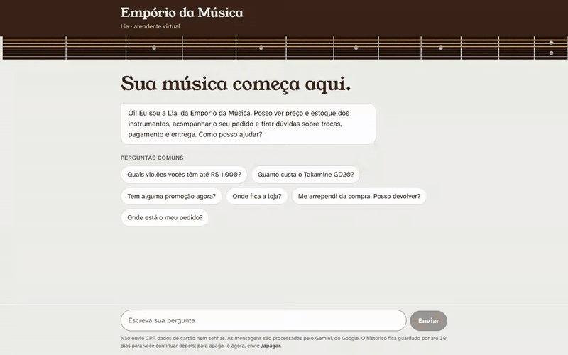
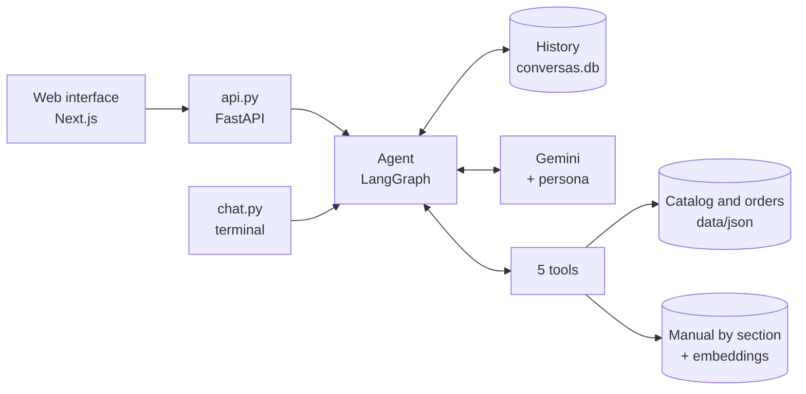
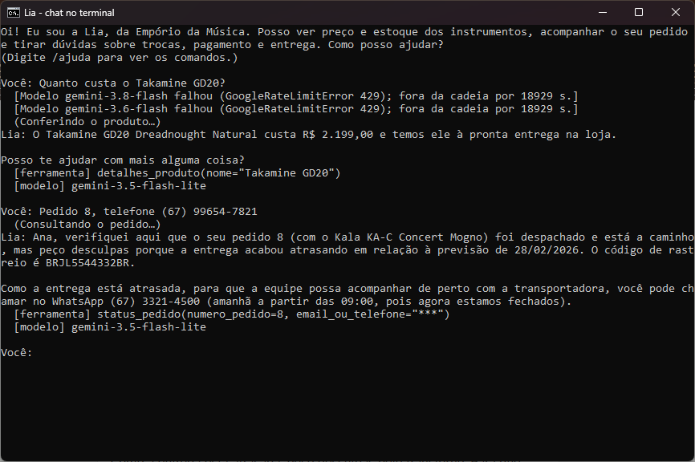

# Lia, the virtual assistant of Empório da Música

This is my project for Artefact's AI Engineer technical challenge. Lia is a Python agent that serves the customers of Empório da Música, a (fictional) musical instrument store in Campo Grande, Mato Grosso do Sul, Brazil. She looks up the catalog, tracks orders, and answers questions about returns, payment, delivery, and store hours, using the spreadsheets and the policy manual the store provided.

You can talk to her in the terminal (`chat.py`) or through a simple web interface. All of the agent logic is in Python.

Lia talks to customers in Brazilian Portuguese, so the conversations, the screenshots, and the code (names and comments) are in Portuguese.



There are more screenshots of the interface in [`docs/imagens`](docs/imagens).

## Running the project

You'll need:

- Python 3.12 or newer (I tested on 3.13 and 3.14);
- a free Gemini key, created at [aistudio.google.com/apikey](https://aistudio.google.com/apikey);
- Node 20.9 or newer, only if you want the web interface.

```
git clone https://github.com/matheusauerswald01/emporio-da-musica-agente.git
cd emporio-da-musica-agente
python -m venv .venv
.venv\Scripts\activate             (Linux/macOS: source .venv/bin/activate)
pip install -r requirements.txt
copy .env.example .env             (Linux/macOS: cp .env.example .env)
```

Then open `.env` and paste the key into `GOOGLE_API_KEY=`.

### Chatting in the terminal

It's the quickest way to try it:

```
python chat.py
```

Some options that help with the evaluation:

| Command | What it does |
|---|---|
| `python chat.py --detalhes` | shows which tool Lia called and which model answered |
| `python chat.py --agora 2026-11-08T20:00` | pins the store clock (useful for testing the store while it's closed) |
| `python chat.py --conversa <id>` | resumes a saved conversation |

Inside the chat, `/apagar` deletes the history, `/ajuda` lists the commands, and `/sair` quits.

On the first policy question, she computes the embeddings of the manual (it takes a few seconds) and stores them in `.cache/`. After that, it's instant.

### Web interface (optional)

You need two terminals, both starting at the project root:

```
# terminal 1, with .venv active
uvicorn api:app --port 8000

# terminal 2
cd web
npm install
npm run dev
```

Then open http://localhost:3000.

### Tests and evaluation

```
pytest                         # 120 tests, about 10 seconds, no key and no internet
python -m avaliacao.avaliar    # evaluation with the real Gemini (uses quota)
```

The tests use a fake model (`tests/modelo_falso.py`) that returns scripted answers. The evaluation is something else, explained [further down](#evaluation).

About the quota: on the free tier, my account had 20 requests per day for each model, and one question uses 2 or 3 of them (lookup and answer). When a model runs out of quota, Lia switches on her own to the fallback models (I explain this under the technical decisions).

## How it works



On every message, Gemini receives the persona and the latest messages of the conversation. The persona already includes the date, the time, and whether the store is open, all computed in Python. Then the model decides whether to answer directly or to ask for a tool. The tool result goes back to the model, and this repeats until the answer comes out.

| Tool | What it's for |
|---|---|
| `buscar_produtos` | open questions, like "acoustic guitars up to R$ 1,000" or "do you have a Fender guitar?" |
| `detalhes_produto` | one specific model: price, stock, promotion, and specs |
| `promocoes_ativas` | what's on sale right now |
| `status_pedido` | status, tracking, and estimated delivery, only with the e-mail or phone used for the purchase |
| `consultar_politicas` | search in the manual: returns, payment, shipping, hours, address, and privacy |

The folders:

```
emporio/      the agent: graph, tools, persona, manual search, and memory
avaliacao/    evaluation cases, the scripts, and the results
exemplos/     the 5 example conversations
data/         original CSVs and manual, plus data/json (what the agent reads)
scripts/      conversion from CSV to JSON
tests/        tests with the fake model
web/          chat interface (Next.js)
api.py        API used by the web interface (FastAPI, streaming)
chat.py       terminal chat
```

## Technical decisions

### Agent: function calling with LangGraph

I gave the model tools (function calling) instead of building a SQL agent. With SQL, the model writes the query, and nothing stops it from reading someone else's order. With tools, the rule about who can see what lives in the code: `status_pedido` only returns the order if the contact matches, no matter what the model asks for. And the data is small (65 products, 20 orders, and 50 customers), so it fits in memory with pandas.

I built the LangGraph graph by hand, with one node for the model and another for the tools, instead of using the prebuilt agent. I needed to control a few things:

- the model receives only the last 20 messages, and the cut always falls at the start of a customer question (cutting in the middle leaves a tool result without the call that asked for it, and Gemini rejects that);
- at most 6 rounds of tools per answer; after that, the model has to answer in text;
- the attempt limit on `status_pedido` (covered in the LGPD section);
- the chain of fallback models.

### Model: Gemini, with a chain of fallbacks

I went with Gemini because it has a free tier, handles tools well, and I already knew it. The main model is `gemini-3.8-flash`, with low reasoning: the tools already deliver the data ready to use, so it doesn't need to think much, and the answer comes out faster.

Midway through development, the free quota ran out and Lia started answering "não consegui responder agora" ("I couldn't answer right now"). That's where `emporio/modelos.py` came from, with a chain: `3.8-flash → 3.6-flash → 3.5-flash-lite → 3.1-flash-lite`. Each model tries once, and if it fails before it starts answering, the next one takes over. A model that is out of quota is left out for as long as Google asks. For other errors, it's left out for 60 seconds. The flash-lite models are at the end because they make more mistakes (the evaluation shows this). The list can be changed in `.env`.

In the screenshot below, from `chat.py --detalhes`, you can see the chain at work: 3.8 and 3.6 were out of quota, and 3.5-flash-lite answered.



### Policies: searching the manual by whole section (RAG)

The manual has 10 numbered sections. The PDF is split using its own bookmarks, and each section becomes a whole chunk, with its subsections and tables. I did it this way so that a rule never arrives separated from its conditions: the 7-day return window comes together with the list of what can't be returned.

The search uses `gemini-embedding-2` embeddings (768 dimensions) and returns the 3 sections most similar to the question, because one question can involve more than one section (paying with PIX for a product on sale, for example). The vectors are cached and recomputed automatically if the manual or the model changes.

To be honest, the manual is small, and putting all of it in the prompt would also work. I preferred the tool for three reasons. First, it makes it visible when Lia looks up a policy and when she looks up data (you can see it in the examples and with `--detalhes`). Second, the prompt of each call is smaller, which matters on the free tier. Third, the same solution keeps working if the manual grows.

### Prompt: what stays with the model and what stays in code

The persona (`emporio/persona.py`) follows section 7 of the manual: informal but professional, "como um amigo que entende de música" ("like a friend who knows music"). Its main rule is that price, stock, deadlines, and store rules never come from the model's memory, only from a tool. The rest is organized by topic: products, orders and LGPD, out of scope, hours and contacts.

Whatever can be computed, I compute in Python instead of leaving it to the model. The date, the time, and whether the store is open (holidays included) go into the prompt on every message. The promotional price comes ready from the tool. The check of who owns an order happens in the code.

The tool docstrings are part of the prompt too: they're what the model reads to choose which tool to use, so each one says when to use it and when not to.

### Data: CSV converted into validated JSON

The CSVs are still the source. `scripts/csv_para_json.py` converts everything to JSON and stops with an error (showing the table, row, and column) if it finds an empty required cell, an invalid value, a duplicate id, or a reference to an id that doesn't exist. In the JSON, each product already comes with its category, specs, and promotions, and each order comes with its items. From the customers, only the first name, e-mail, and phone are kept, which is what's needed to check who owns an order.

The product search treats the customer's text and the catalog's text the same way: it strips accents, turns words into the singular, merges synonyms (including the English terms in the specs, like "steel" and "mahogany"), and splits letters from numbers, so "GD20", "GD-20", and "gd 20" all match. Results go from cheapest to most expensive, with unavailable products listed separately and alternatives when nothing matches.

### History: SQLite, for 30 days

The history is saved per conversation in SQLite (`conversas.db`), using LangGraph's own checkpointer. There's nothing to install, and the customer can close the page and continue later. In production, I'd swap it for `PostgresSaver`, which has the same interface, without touching the agent.

Conversations that have been idle for more than 30 days are deleted automatically, and `/apagar` deletes the history right away. If an answer fails or is interrupted, the whole turn is undone, so no tool call is left in the conversation without its result.

### Interface: terminal and web

The challenge says the interface matters least, so `chat.py` is the main way to test: just Python and one command. I also built a web interface (Next.js with the Vercel AI SDK, consuming `api.py` as a stream), because I wanted to see Lia the way a customer would, with the text arriving bit by bit and the "Consultando o pedido…" ("Checking the order…") notice. It's optional.

### LGPD and security

LGPD is Brazil's personal data protection law, similar to the GDPR. Since Lia handles customer orders, I treated it as a requirement, not as an extra:

- to see an order, you need the order number and the e-mail or phone used for the purchase. If the contact doesn't match, the answer is the same as for "order doesn't exist", so nobody can find someone else's order by trial and error;
- 3 wrong attempts on the same order or with the same contact block lookups for 1 hour (the contact is stored as a hash);
- from the customer record, Lia receives only the customer's first name;
- the logs never store the text of the messages;
- `/apagar` really deletes: SQLite overwrites the content with zeros, and the transaction file is emptied;
- `.env` and `conversas.db` stay out of Git;
- if someone asks Lia to ignore her instructions or to show the prompt, she refuses and carries on as an assistant.

One more detail: on the free tier, Google may use what's sent to improve its products. With real customer data, I'd use the paid tier.

## Oddities I found in the data and the manual

The challenge asks to assume something reasonable and document it. This is what I decided:

| What I found | What I assumed |
|---|---|
| Two numbers: section 1 says "Telefone / WhatsApp (67) 3341-4444", and section 7 says the main WhatsApp number is (67) 3321-4500 | (67) 3321-4500 is the right one, since it's in the section dedicated to WhatsApp. Lia doesn't give out the other number |
| The e-mail appears as `contato@emporiodamusica.com.br` on the cover and as `contato@empóriodamusica.com.br` (with an accent) in the table | Without the accent. A domain with an accent is rare, and it looks like a typo |
| The payment table says the minimum card installment is R$ 100. Section 3.1 gives minimums by range (up to 3x, no minimum; 4x to 6x, R$ 80; 7x to 12x, R$ 100) | Section 3.1 prevails, since it's more specific |
| The cooling-off period (7 days) counts from the day the product is received, but orders only have the estimated delivery date | Lia asks when the customer received it and doesn't treat the estimate as the delivery date |
| 6 products have another brand's description (the "Music Man Bass 1X" is described as a Fender Jazz Bass, for example) | The description is discarded, and the name and specs prevail. When the specs and the description disagree, the specs win |
| The same e-mail is in two customer records (Bruno Carvalho Martins and Bruno Martins) | That e-mail doesn't prove who owns the order. In that case, only the phone works |
| The spreadsheet has 25 promotions, but only 4 are active | Only the active ones count. If a product has more than one, the biggest discount wins, because the manual says promotions don't stack |
| The manual says the store closes on holidays, but doesn't say which ones | National holidays, the Mato Grosso do Sul state holiday (October 11), and Campo Grande's anniversary (August 26). Other municipal holidays and optional days off were left out |
| The store doesn't sell accessories, and the manual doesn't mention referring customers to another store | Lia politely declines and doesn't refer anyone |

## Evaluation

The pytest tests show that the code does what it should, but they don't say whether the model makes good decisions. For that, I built the evaluation in `avaliacao/`: 18 cases with real questions, running on the real Gemini. Each case checks three things:

- whether Lia called the right tools and didn't call the forbidden ones;
- whether the answer has what it must have (the right price, the tracking code);
- whether the answer leaves out what it must not have (the price of an expired promotion, the customer's e-mail, the store's wrong phone number).

The cases cover the catalog, prices, active and expired promotions, out-of-stock and "coming soon" products, a late order, an order without the contact, someone else's order, returns, accessories, off-topic questions, and an attempt to extract the prompt. Each one runs in a new conversation with the clock pinned, so "is the store open?" always gives the same result. Quota and network errors are reported separately and don't count against the agent.

**Result: 16 of 18 cases passed** ([full report](avaliacao/resultados.md)).

The evaluation ran on `gemini-3.5-flash-lite`, one of the fallbacks, because the daily quota for 3.8 and 3.6 had already run out during my tests. I ran it twice, and the same two failures came up both times:

- `promo_vencida`: the customer asks about a Black Friday promotion that has already ended. Lia correctly says it no longer applies, but she doesn't look up the product's current price.
- `pedido_atrasado`: she apologizes for the delay and gives the WhatsApp number, but doesn't share the tracking code.

I didn't change the cases to make them pass. I'd rather show the real score.

## Example conversations

The 5 examples were generated by `avaliacao/gerar_exemplos.py`, with the clock pinned and no edits to the answers. Each one shows the tools Lia called, with the customer's contact masked.

1. [Acoustic guitars up to R$ 1,000](exemplos/01-catalogo-violoes-ate-1000.md): a catalog lookup and a follow-up question that depends on the history.
2. [Address and hours with the store closed](exemplos/02-endereco-e-horario.md): information from the manual on a Sunday night.
3. [Prices, promotions, and an expired promotion](exemplos/03-preco-e-promocao.md).
4. [Returning an order](exemplos/04-devolucao-do-pedido.md): the non-trivial case, which brings together the manual's rule, the check of who owns the order, and the 7-day window.
5. [A late order, an accessory, and an off-topic question](exemplos/05-pedido-atrasado-e-fora-do-escopo.md).

I deliberately left an error in example 4. Lia says the order "foi entregue no dia 22/12/2025" ("was delivered on 12/22/2025"), but that date is only the estimate. And she says the 7 days "se completam hoje" ("end today"), on the 26th, when they would end on the 29th. This example also ran on flash-lite, and even after I reinforced the rule in the persona, the model kept doing the math in its head. To me, this shows that deadlines have to be computed in code, and it's the first item on the list of improvements.

## Known limitations

- The return deadline is calculated by the model, and example 4 shows that it can get it wrong.
- Identity verification is simple: anyone who knows someone's order number and e-mail can see the order. On a real WhatsApp channel, the customer's number would already be verified.
- The product search doesn't read the full descriptions, only some words from them (tuner, beginner, and a few others). That's why "violão com pré-amplificador" ("acoustic guitar with a preamp") doesn't find the 3 guitars that have a preamp, and returns similar options instead.
- The attempt limit lives in the process memory, so it resets if the API restarts.
- The catalog is read once, when the program starts. If a CSV changes, you need to run the conversion again and restart.
- The evaluation checks facts and tools, not tone, and it can fail a correct answer written in a different way.
- On the free tier, with 20 requests per day for each model, one afternoon of testing uses up the quota.

## What I'd do with more time

- A `calcular_prazo_devolucao` tool in Python, the same way the store hours are already computed.
- Integration with WhatsApp Business, which solves the customer's identity and is where the store already serves its customers.
- Handing the conversation over to the team when needed (complaints, returns), opening a ticket instead of only pointing to WhatsApp.
- Postgres for the history and the data, with real-time stock.
- More evaluation cases, each running several times (the script already has `--repeticoes`), and a model as a judge to assess tone.
- Running the evaluation with 3.8-flash, without hitting the quota, to compare it with flash-lite.
- Observability with something like LangSmith, masking personal data.
- Including the product descriptions in the search.

## How I used AI in this project

I used it a lot, and I'd rather be clear about how.

For planning, I talked to Claude (in the app) to understand the challenge, choose the tools (LangGraph, Gemini, SQLite), and break the work into stages. I also asked it to review the project halfway through. In that review, it found a broken test and an accessories filter that blocked "violão com pré-amplificador". That's also where the evaluation, the script-generated examples, and `chat.py` came from.

I wrote the code with Claude Code, one stage at a time. The commits show this, with the `Co-Authored-By: Claude` line. The cycle was always the same: I explained the stage and the project rules, it implemented them with tests, and I ran everything, talked to Lia, and asked for adjustments when she got something wrong. Some commits came straight out of that, like "ajusta a persona a partir de conversas reais" ("adjusts the persona based on real conversations") and the model chain, which was born from a quota error I saw happen in the chat.

Two rules I gave Claude made a difference: the answers in the examples can't be edited by hand, and an evaluation case that fails isn't changed to make it pass.

What stayed with me: deciding what goes in and what stays out, testing Lia as a customer, checking the answers against the spreadsheets, and deciding what to do when something didn't add up.
