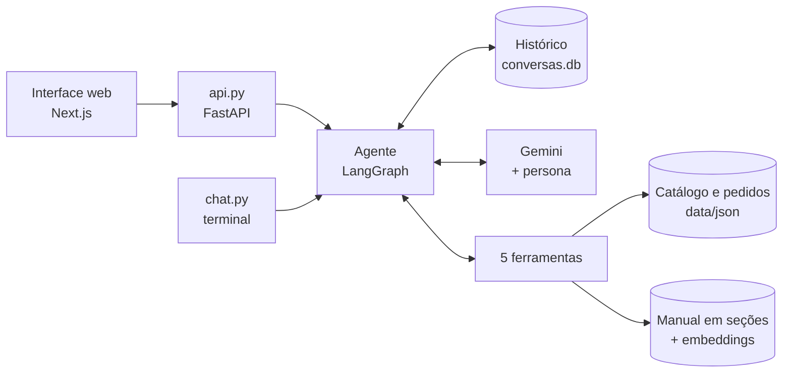

# Lia, a atendente virtual da Empório da Música

Este é o meu projeto para o desafio técnico de AI Engineer da Artefact. A Lia é um agente em Python que atende os clientes da Empório da Música, uma loja (fictícia) de instrumentos em Campo Grande/MS. Ela consulta o catálogo, acompanha pedidos e tira dúvidas sobre trocas, pagamento, entrega e horário, usando as planilhas e o manual de políticas que a loja forneceu.

Dá pra conversar com ela pelo terminal (`chat.py`) ou por uma interface web simples. A lógica do agente é toda em Python.


Tem mais prints da interface em [`docs/imagens`](docs/imagens).

## Rodando o projeto

Você vai precisar de:

- Python 3.12 ou mais novo (testei no 3.13 e no 3.14);
- uma chave grátis do Gemini, gerada em [aistudio.google.com/apikey](https://aistudio.google.com/apikey);
- Node 20.9 ou mais novo, só se quiser a interface web.

```
git clone https://github.com/matheusauerswald01/emporio-da-musica-agente.git
cd emporio-da-musica-agente
python -m venv .venv
.venv\Scripts\activate             (Linux/macOS: source .venv/bin/activate)
pip install -r requirements.txt
copy .env.example .env             (Linux/macOS: cp .env.example .env)
```

Depois é só abrir o `.env` e colar a chave em `GOOGLE_API_KEY=`.

### Conversar pelo terminal

É o jeito mais rápido de testar:

```
python chat.py
```

Algumas opções que ajudam na avaliação:

| Comando | O que faz |
|---|---|
| `python chat.py --detalhes` | mostra qual ferramenta a Lia chamou e qual modelo respondeu |
| `python chat.py --agora 2026-11-08T20:00` | fixa o relógio da loja (serve pra testar a loja fechada) |
| `python chat.py --conversa <id>` | continua uma conversa salva |

Dentro do chat, `/apagar` apaga o histórico, `/ajuda` lista os comandos e `/sair` encerra.

Na primeira pergunta sobre políticas, ela calcula os embeddings do manual (leva alguns segundos) e guarda em `.cache/`. Das próximas vezes é na hora.

### Interface web (opcional)

São dois terminais, os dois começando na raiz do projeto:

```
# terminal 1, com o .venv ativo
uvicorn api:app --port 8000

# terminal 2
cd web
npm install
npm run dev
```

Aí é abrir http://localhost:3000.

### Testes e avaliação

```
pytest                         # 120 testes, uns 10 segundos, sem chave e sem internet
python -m avaliacao.avaliar    # avaliação com o Gemini de verdade (gasta cota)
```

Os testes usam um modelo falso (`tests/modelo_falso.py`) que devolve respostas roteirizadas. A avaliação é outra coisa e está explicada [mais abaixo](#avaliação).

Sobre a cota: no plano grátis, a minha conta tinha 20 pedidos por dia em cada modelo, e uma pergunta gasta 2 ou 3 (consulta e resposta). Quando a cota de um modelo acaba, a Lia passa sozinha para os modelos reserva (explico isso nas decisões).

## Como funciona



A cada mensagem, o Gemini recebe a persona e as últimas mensagens da conversa. A persona já vem com a data, a hora e se a loja está aberta, calculados em Python. Aí o modelo decide se responde direto ou se pede uma ferramenta. O resultado da ferramenta volta pra ele, e isso se repete até sair a resposta.

| Ferramenta | Pra quê |
|---|---|
| `buscar_produtos` | perguntas abertas, como "violões até R$ 1.000" ou "tem guitarra Fender?" |
| `detalhes_produto` | um modelo específico: preço, estoque, promoção e especificações |
| `promocoes_ativas` | o que está em promoção agora |
| `status_pedido` | situação, rastreio e previsão, só com o e-mail ou telefone da compra |
| `consultar_politicas` | busca no manual: trocas, pagamento, frete, horário, endereço e privacidade |

As pastas:

```
emporio/      o agente: grafo, ferramentas, persona, busca no manual e memória
avaliacao/    casos da avaliação, os scripts e o resultado
exemplos/     as 5 conversas de exemplo
data/         CSVs e manual originais, e data/json (o que o agente lê)
scripts/      conversão dos CSVs para JSON
tests/        testes com o modelo falso
web/          interface de chat (Next.js)
api.py        API que a web usa (FastAPI, com stream)
chat.py       chat no terminal
```

## Decisões técnicas

### Agente: function calling com LangGraph

Dei ferramentas ao modelo (function calling) em vez de montar um agente de SQL. Com SQL, é o modelo que escreve a consulta, e nada impede que ele leia o pedido de outra pessoa. Com ferramentas, a regra de quem pode ver o quê fica no código: o `status_pedido` só devolve o pedido se o contato bater, não importa o que o modelo peça. E os dados são pequenos (65 produtos, 20 pedidos e 50 clientes), então cabem na memória com pandas.

Montei o grafo do LangGraph na mão, com um nó para o modelo e outro para as ferramentas, em vez de usar o agente pronto. Precisava controlar algumas coisas:

- o modelo recebe só as últimas 20 mensagens, e o corte é sempre no começo de uma pergunta do cliente (cortando no meio, sobra resultado de ferramenta sem a chamada, e o Gemini recusa);
- no máximo 6 rodadas de ferramenta por resposta, depois disso ele é obrigado a responder em texto;
- o limite de tentativas do `status_pedido` (está na parte de LGPD);
- a fila de modelos reserva.

### Modelo: Gemini, com uma fila de reservas

Fui de Gemini porque tem plano grátis, chama ferramentas bem e eu já conhecia. O principal é o `gemini-3.8-flash`, com raciocínio baixo: as ferramentas já entregam o dado pronto, então ele não precisa pensar muito, e a resposta sai mais rápido.

No meio do desenvolvimento, a cota grátis acabou e a Lia começou a responder "não consegui responder agora". Daí veio o `emporio/modelos.py`, com uma fila: `3.8-flash → 3.6-flash → 3.5-flash-lite → 3.1-flash-lite`. Cada modelo tenta uma vez, e se falhar antes de começar a responder, o próximo assume. O modelo sem cota fica de fora pelo tempo que o Google pede. Nos outros erros, fica de fora por 60 segundos. Os flash-lite estão no fim porque erram mais (a avaliação mostra isso). A lista pode ser trocada no `.env`.

No print abaixo, do `chat.py --detalhes`, dá pra ver a fila funcionando: o 3.8 e o 3.6 estavam sem cota, e o 3.5-flash-lite respondeu.


### Políticas: busca no manual por seção inteira (RAG)

O manual tem 10 seções numeradas. O PDF é dividido pelos próprios marcadores dele, e cada seção vira um trecho inteiro, com subseções e tabelas. Fiz assim para uma regra não chegar separada das condições dela: o prazo de 7 dias para devolver vem junto da lista do que não pode ser devolvido.

A busca usa embeddings do `gemini-embedding-2` (768 dimensões) e devolve as 3 seções mais parecidas com a dúvida, porque uma pergunta pode envolver mais de uma seção (pagar no PIX um produto em promoção, por exemplo). Os vetores ficam em cache e são recalculados sozinhos se o manual ou o modelo mudar.

Pra ser sincero, o manual é pequeno, e colocar ele inteiro no prompt também funcionaria. Preferi a ferramenta por três motivos. Primeiro, fica visível quando a Lia consulta política e quando consulta dado (dá pra ver nos exemplos e no `--detalhes`). Segundo, o prompt de cada chamada fica menor, o que pesa no plano grátis. Terceiro, a mesma solução continua servindo se o manual crescer.

### Prompt: o que fica com o modelo e o que fica no código

A persona (`emporio/persona.py`) segue a seção 7 do manual: informal mas profissional, "como um amigo que entende de música". A regra principal dela é que preço, estoque, prazo e regra da loja nunca vêm da memória do modelo, e sim de uma ferramenta. O resto está separado por assunto: produtos, pedidos e LGPD, fora do escopo, horário e contatos.

O que dá pra calcular, eu calculo em Python em vez de deixar pro modelo. A data, a hora e se a loja está aberta (com feriados) entram no prompt a cada mensagem. O preço com promoção já sai pronto da ferramenta. A verificação do dono do pedido acontece no código.

As docstrings das ferramentas também são parte do prompt: é o que o modelo lê para escolher qual usar, então cada uma diz quando usar e quando não usar.

### Dados: CSV convertido em JSON validado

Os CSVs continuam sendo a fonte. O `scripts/csv_para_json.py` converte tudo para JSON e para com erro (mostrando tabela, linha e coluna) se achar célula obrigatória vazia, valor inválido, id repetido ou referência a um id que não existe. No JSON, cada produto já vem com a categoria, as especificações e as promoções, e cada pedido vem com os itens. Dos clientes, vão só o primeiro nome, o e-mail e o telefone, que é o necessário para conferir o dono de um pedido.

A busca de produtos trata o texto do cliente e o do catálogo do mesmo jeito: tira acento, passa para o singular, junta sinônimos (inclusive os termos em inglês das especificações, como "steel" e "mahogany") e separa letras de números, para "GD20", "GD-20" e "gd 20" darem no mesmo. Os resultados vêm do mais barato para o mais caro, com os indisponíveis separados e alternativas quando nada bate.

### Histórico: SQLite, por 30 dias

O histórico fica salvo por conversa num SQLite (`conversas.db`), usando o checkpointer do próprio LangGraph. Não precisa instalar nada, e o cliente pode fechar a página e continuar depois. Em produção, eu trocaria pelo `PostgresSaver`, que tem a mesma interface, sem mexer no agente.

Conversas paradas há mais de 30 dias são apagadas sozinhas, e o `/apagar` apaga na hora. Se uma resposta falha ou é interrompida, o turno inteiro é desfeito, para não sobrar chamada de ferramenta sem resultado na conversa.

### Interface: terminal e web

O enunciado diz que a interface é o de menos, então o `chat.py` é o caminho principal para testar: só Python e um comando. Também fiz uma interface web (Next.js com o Vercel AI SDK, consumindo a `api.py` em stream), porque queria ver a Lia do jeito que o cliente veria, com o texto chegando aos poucos e o aviso "Consultando o pedido…". Ela é opcional.

### LGPD e segurança

Como a Lia lida com pedidos de clientes, tratei isso como requisito, não como extra:

- para ver um pedido, precisa do número e do e-mail ou telefone da compra. Se o contato não bater, a resposta é a mesma de "pedido não existe", para ninguém descobrir pedido alheio por tentativa;
- 3 tentativas erradas no mesmo pedido ou com o mesmo contato bloqueiam a consulta por 1 hora (o contato fica guardado como hash);
- do cadastro, a Lia recebe só o primeiro nome do cliente;
- os logs nunca guardam o texto das mensagens;
- o `/apagar` apaga de verdade: o SQLite sobrescreve o conteúdo com zeros e o arquivo de transações é esvaziado;
- `.env` e `conversas.db` ficam fora do Git;
- se alguém pede para a Lia ignorar as instruções ou mostrar o prompt, ela recusa e continua como atendente.

Um detalhe: no plano grátis, o Google pode usar o que é enviado para melhorar os produtos dele. Com dados reais de clientes, eu usaria o plano pago.

## O que encontrei de estranho nos dados e no manual

O enunciado pede para assumir algo razoável e documentar. Foi isso que eu decidi:

| O que encontrei | O que eu assumi |
|---|---|
| Dois números: a seção 1 diz "Telefone / WhatsApp (67) 3341-4444", e a seção 7 diz que o WhatsApp principal é o (67) 3321-4500 | Vale o 3321-4500, que está na seção dedicada ao WhatsApp. A Lia não passa o outro número |
| O e-mail aparece como `contato@emporiodamusica.com.br` na capa e como `contato@empóriodamusica.com.br` (com acento) na tabela | Sem acento. Domínio com acento é raro, e parece erro de digitação |
| A tabela de pagamento diz que a parcela mínima no cartão é R$ 100. A seção 3.1 dá mínimos por faixa (até 3x sem mínimo, de 4x a 6x R$ 80, de 7x a 12x R$ 100) | Vale a seção 3.1, que é mais específica |
| O prazo de arrependimento (7 dias) conta a partir do recebimento, mas os pedidos só têm a previsão de entrega | A Lia pergunta quando o cliente recebeu e não trata a previsão como data de entrega |
| 6 produtos têm a descrição de outra marca (o "Music Man Bass 1X" é descrito como um Fender Jazz Bass, por exemplo) | A descrição é descartada, e valem o nome e as especificações. Quando especificação e descrição divergem, vale a especificação |
| O mesmo e-mail está em dois cadastros (Bruno Carvalho Martins e Bruno Martins) | Esse e-mail não prova quem é o dono do pedido. Nesse caso, só o telefone confere |
| A planilha tem 25 promoções, mas só 4 estão ativas | Valem só as ativas. Se um produto tiver mais de uma, vale a de maior desconto, porque o manual diz que promoções não acumulam |
| O manual diz que a loja fecha nos feriados, mas não diz quais | Feriados nacionais, o estadual de MS (11/10) e o aniversário de Campo Grande (26/08). Outros feriados municipais e pontos facultativos ficaram de fora |
| A loja não vende acessórios, e o manual não fala em indicar outra loja | A Lia recusa com educação e não indica ninguém |

## Avaliação

Os testes do pytest mostram que o código faz o que deveria, mas não dizem se o modelo decide bem. Para isso, montei a avaliação em `avaliacao/`: 18 casos com perguntas reais, rodando no Gemini de verdade. Cada caso confere três coisas:

- se a Lia chamou as ferramentas certas e não chamou as proibidas;
- se a resposta tem o que precisa ter (o preço certo, o código de rastreio);
- se a resposta não tem o que não pode ter (o preço de uma promoção vencida, o e-mail do cliente, o telefone errado da loja).

Os casos cobrem catálogo, preço, promoção ativa e vencida, produto sem estoque e "em breve", pedido atrasado, pedido sem contato, pedido de outra pessoa, devolução, acessório, assunto fora da loja e tentativa de pegar o prompt. Cada um roda numa conversa nova e com o relógio fixado, para "a loja está aberta?" dar sempre o mesmo resultado. Erro de cota ou de rede aparece separado e não conta contra o agente.

**Resultado: 16 de 18 casos passaram** ([relatório completo](avaliacao/resultados.md)).

A avaliação rodou no `gemini-3.5-flash-lite`, um dos reservas, porque a cota do dia do 3.8 e do 3.6 já tinha acabado nos meus testes. Rodei duas vezes, e as mesmas duas falhas se repetiram:

- `promo_vencida`: o cliente pergunta de uma promoção de Black Friday que já acabou. A Lia diz certo que ela não vale mais, mas não busca o preço atual do produto.
- `pedido_atrasado`: ela pede desculpas pelo atraso e passa o WhatsApp, mas não informa o código de rastreio.

Não mudei os casos para eles passarem. Prefiro mostrar o placar real.

## Exemplos de conversa

Os 5 exemplos foram gerados pelo `avaliacao/gerar_exemplos.py`, com o relógio fixado e sem nenhuma edição nas respostas. Cada um mostra as ferramentas que a Lia chamou, com o contato do cliente mascarado.

1. [Violões até R$ 1.000](exemplos/01-catalogo-violoes-ate-1000.md): consulta ao catálogo e uma pergunta de continuação que depende do histórico.
2. [Endereço e horário com a loja fechada](exemplos/02-endereco-e-horario.md): informação do manual num domingo à noite.
3. [Preço, promoções e uma promoção vencida](exemplos/03-preco-e-promocao.md).
4. [Devolução de um pedido](exemplos/04-devolucao-do-pedido.md): o caso não trivial, que junta a regra do manual, a verificação do dono do pedido e o prazo de 7 dias.
5. [Pedido atrasado, acessório e assunto fora da loja](exemplos/05-pedido-atrasado-e-fora-do-escopo.md).

Deixei de propósito um erro no exemplo 4. A Lia diz que o pedido "foi entregue no dia 22/12/2025", mas essa data é só a previsão. E diz que os 7 dias "se completam hoje", no dia 26, quando terminariam no dia 29. Esse exemplo também rodou no flash-lite, e mesmo depois de eu reforçar a regra na persona, ele continuou fazendo a conta de cabeça. Para mim, isso mostra que prazo tem que ser calculado em código, e é o primeiro item da lista de melhorias.

## Limitações conhecidas

- O prazo de devolução é calculado pelo modelo, e o exemplo 4 mostra que ele pode errar.
- A confirmação de identidade é simples: quem souber o número do pedido e o e-mail de alguém consegue ver o pedido. No WhatsApp de verdade, o número do cliente já viria confirmado.
- A busca de produtos não lê as descrições inteiras, só algumas palavras delas (afinador, iniciante e outras). Por isso, "violão com pré-amplificador" não encontra os 3 violões que têm pré-amplificador e devolve opções parecidas.
- O limite de tentativas fica na memória do processo, então zera se a API reiniciar.
- O catálogo é lido uma vez, quando o programa sobe. Se o CSV mudar, é preciso rodar a conversão de novo e reiniciar.
- A avaliação confere fatos e ferramentas, não o tom, e pode reprovar uma resposta certa escrita de outro jeito.
- No plano grátis, com 20 pedidos por dia em cada modelo, uma tarde de testes acaba com a cota.

## O que eu faria com mais tempo

- Uma ferramenta `calcular_prazo_devolucao` em Python, do mesmo jeito que o horário da loja já é calculado.
- Integração com o WhatsApp Business, que resolve a identidade do cliente e é onde a loja já atende.
- Passar a conversa para a equipe quando precisar (reclamação, devolução), abrindo um chamado em vez de só indicar o WhatsApp.
- Postgres para o histórico e para os dados, com o estoque em tempo real.
- Mais casos na avaliação, cada um rodando várias vezes (o script já tem `--repeticoes`), e um modelo como juiz para avaliar o tom.
- Rodar a avaliação com o 3.8-flash, sem esbarrar na cota, para comparar com o flash-lite.
- Observabilidade com algo como o LangSmith, mascarando os dados pessoais.
- Incluir as descrições dos produtos na busca.

## Como usei IA neste projeto

Usei bastante, e prefiro deixar claro como foi.

No planejamento, conversei com o Claude (no app) para entender o enunciado, escolher as ferramentas (LangGraph, Gemini, SQLite) e quebrar o trabalho em etapas. Também pedi para ele revisar o projeto no meio do caminho. Nessa revisão, ele achou um teste quebrado e um filtro de acessórios que bloqueava "violão com pré-amplificador". Foi daí também que vieram a avaliação, os exemplos gerados por script e o `chat.py`.

O código eu escrevi com o Claude Code, uma etapa por vez. Os commits mostram isso, com a linha `Co-Authored-By: Claude`. O ciclo era sempre o mesmo: eu explicava a etapa e as regras do projeto, ele implementava com testes, e eu rodava, conversava com a Lia e pedia ajustes quando ela errava. Alguns commits saíram direto disso, como o "ajusta a persona a partir de conversas reais" e a fila de modelos, que nasceu de um erro de cota que eu vi acontecer no chat.

Duas regras que passei para o Claude e que fizeram diferença: as respostas dos exemplos não podem ser editadas à mão, e caso da avaliação que falha não é alterado para passar.

Ficaram comigo as decisões do que entra e do que fica de fora, os testes da Lia como cliente, a conferência das respostas com as planilhas e a decisão sobre o que fazer quando algo não batia.
